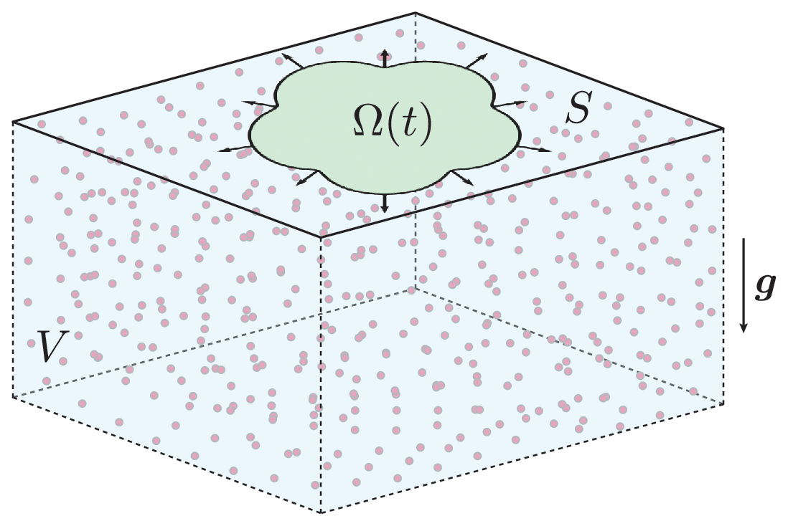

<p align="center">
  <picture>
    <source media="(prefers-color-scheme: dark)" srcset="docs/assets/fig1-dark.png">
    
  </picture>
</p>

# Instability of microbial droplets growing on viscous substrates

**Abstract:** We develop and analyze a model for a flat microbial droplet growing on the surface of a three-dimensional viscous fluid. The model describes growth-induced stresses at the fluid surface, density variations in the bulk due to nutrient consumption, and the resulting fluid flows that arise. We reformulate this free-boundary problem as a system of integro-differential equations defined solely on the microbial domain. From this formulation, we identify an axisymmetric solution corresponding to a radially expanding disk and analyze its morphological stability. We find that growth forces stabilize the axisymmetric solution while buoyancy forces destabilize it. We connect these findings to experimental observations.

The model, results, and interactive figures are included at the **[project page](https://scottweady.github.io/microbial-droplets/)**. The article is published in the **[Journal of Fluid Mechanics](https://doi.org/10.1017/jfm.2026.11721)**, and the preprint is available on **[arxiv](https://arxiv.org/abs/2602.13724)**.

## Reproducibility

All data and figures in the manuscript can be generated directly from this repository. The axisymmetric solutions and stability coefficients are computed in Julia, from the repository root:

```bash
julia --project=scripts -e 'using Pkg; Pkg.instantiate()'
cd scripts && julia --project=. main.jl    # writes scripts/results/*.dat
```

The figures are written in MATLAB, from the repository root:

```matlab
cd figs, make_figs, cd ..      % write figs/output/fig-*.pdf
```

The bulk flow fields (Fig. 4) are computed and plotted in Julia:

```bash
julia --project=. -e 'using Pkg; Pkg.instantiate()'
julia --project=. figs/scripts/3DFlow_plot.jl
```

The precomputed data in `data/` is already committed, so `make_figs` can be run directly without re-solving. To use a new solve, copy `scripts/results/*.dat` into `data/`.

Running `main.jl` requires

- [Julia](https://julialang.org)
- [ProjectedSphericalHarmonics.jl](https://github.com/scottweady/ProjectedSphericalHarmonics.jl): installed automatically by `Pkg.instantiate()` from the manifest.

Running `make_figs` requires

- MATLAB
- [cmocean](https://www.mathworks.com/matlabcentral/fileexchange/57773-cmocean-perceptually-uniform-colormaps): add it to your MATLAB path.

## Layout

- `scripts/main.jl`: axisymmetric growth ($p_g$) and buoyancy ($p_b$) solutions on the unit disk, and the stability coefficients $\sigma_g^m$, $\sigma_b^m$, using a projected spherical harmonic expansion of degree $M = 64$
- `data/`: figure data
  - `sol_g.dat`, `sol_b.dat`: axisymmetric solutions at the quadrature nodes (columns $x$, $y$, weight, $p$, $\sigma$)
  - `sigma_g.dat`, `sigma_b.dat`: stability coefficients for $m = 0, \dots, 40$
  - `kappa_H.dat`: matching constant $\kappa$ against effective depth $|H|$ (Fig. 9)
- `figs/`: figure scripts, run via `figs/make_figs.m`. Each `figs/scripts/fig_*.m` loads its data from `data/`.
  - `fig_axisymmetric`, `fig_transition`: surface pressure and velocity (Figs. 3, 8)
  - `fig_concentration`: nutrient concentration in the bulk (Fig. 2)
  - `fig_sigma`, `fig_stability`: stability coefficients and stability diagram (Figs. 5–7)
  - `fig_kappa`, `fig_convergence`: effect of depth and numerical validation (Figs. 9, 10)
  - `3DFlow_plot.jl`, `axisymmetric_inplane_velocity.jl`: bulk and surface velocity fields
- `docs/`: the project page (`index.html`), its interactive figures and data (`assets/`), and the scripts that generate them (`makeinteractive.m`, `makeschematic.m`)
